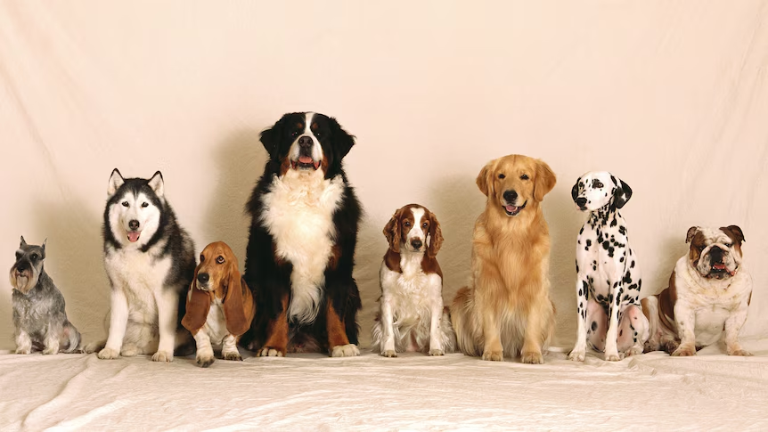
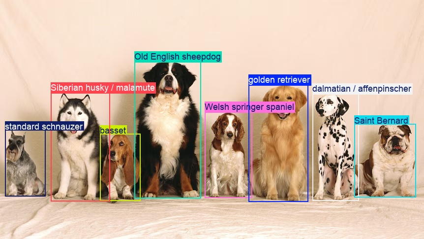
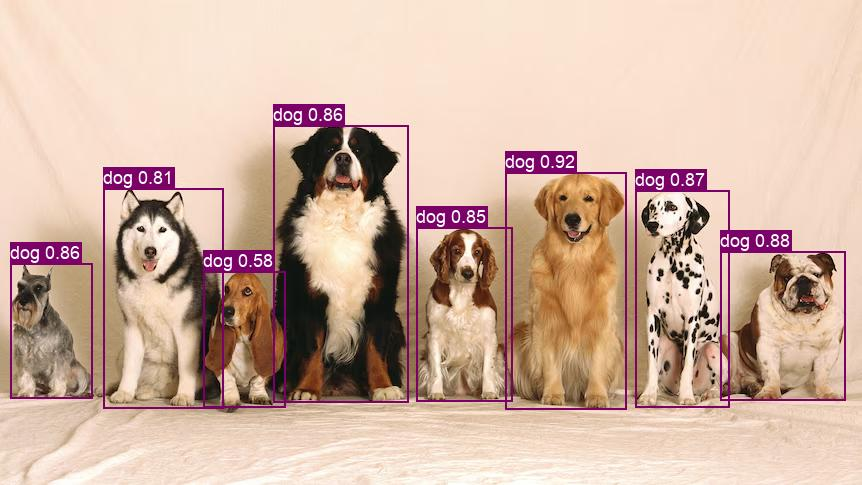
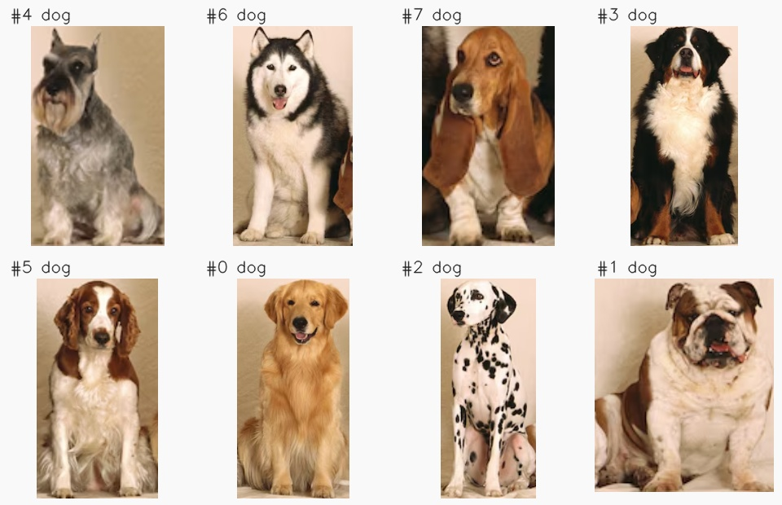

# Detect and Classify

Combine object detection with
[image classification](https://docs.ultralytics.com/tasks/classify/)
to assign more specific labels to individual objects. Start with a detection
pipeline, add bounding-box crops, then classify each crop with a second model.
Each prediction stays paired with its original detection.

This tutorial uses dog breed classification as a worked example. The same
pipeline structure applies to other object categories and classification
tasks with suitable checkpoints and class selections.

Before you begin, follow the [Installation](../installation.md) instructions.
Run the Python snippets in order in the same script or notebook.

| Before | After |
|---|---|
|  |  |

## Detect objects

Begin with `yolo.Predict` and `Select(0)`. The prediction operator returns a
native `list[Results]`; selecting its first item gives us the result for this
single image. Highlighted lines show the operators introduced at each stage.

```python
from ml_pipes.core import Pipeline
from ml_pipes.standard import Select
from ml_pipes.ultralytics import yolo


pipeline = Pipeline(
    [
        yolo.Predict(model="yolo26n.pt", conf=0.25, iou=0.7, imgsz=960),
        Select(0),
    ],
    auto_validate=True,
)
```



The detector returns object categories and boxes. In this sample it finds
all eight dogs, but its `dog` label does not identify a breed. The next stage
selects the category we want to classify.

## Crop selected detections

Keep the detection operators and append `FilterResults` and
`CropResults`. The filter selects an exact detector label: `dog` in
this example. Return a plain `(detections, crops)` tuple: native `Results`
retain the boxes, class IDs, and detection scores, and the BGR crops follow
the same order. No additional data container or package is needed.

First define the filter and crop operators:

```python
import warnings

import numpy as np
import numpy.typing as npt
from ultralytics.engine.results import Results
from ultralytics.utils.plotting import save_one_box

from ml_pipes.operator import Operator

ImageArray = npt.NDArray[np.uint8]


@Operator
class FilterResults:
    def __init__(self, class_name: str) -> None:
        self.class_name = class_name

    def __call__(self, result: Results) -> Results:
        if self.class_name not in result.names.values():
            raise ValueError(f"Detector has no class named {self.class_name!r}.")
        if result.boxes is None:
            empty = result.new()
            empty.update(boxes=np.empty((0, 6), dtype=np.float32))
            return empty
        indices = [
            index
            for index, class_id in enumerate(result.boxes.cls.tolist())
            if result.names[int(class_id)] == self.class_name
        ]
        return result[indices]


@Operator
class CropResults:
    def __init__(self, *, save: bool = False, BGR: bool = True, gain: float = 1.0, pad: int = 0) -> None:
        self.save = save
        self.BGR = BGR
        self.gain = gain
        self.pad = pad

    def __call__(self, result: Results) -> tuple[Results, list[ImageArray]]:
        indices, crops = [], []
        for index, box in enumerate(result.boxes.cpu().numpy()):
            if not np.isfinite(box.xyxy).all():
                warnings.warn(f"Skipping detection {index}: non-finite bounding box.", RuntimeWarning)
                continue
            crop = save_one_box(
                box.xyxy, result.orig_img,
                save=self.save, BGR=self.BGR, gain=self.gain, pad=self.pad,
            )
            if not crop.size:
                warnings.warn(f"Skipping detection {index}: empty bounding-box crop.", RuntimeWarning)
                continue
            indices.append(index)
            crops.append(crop.copy())
        return result[indices], crops
```

`save_one_box` handles crop coordinates and clipping. `save=False` keeps the
crops in memory, `BGR=True` matches the classifier's input, and `gain=1.0,
pad=0` disables the helper's default box expansion. The operator skips invalid
or empty crops together with their detections, preserving alignment. The
original box coordinates and image remain unchanged.

Now extend the same pipeline. Only the highlighted operators are new:

```python hl_lines="5 6"
pipeline = Pipeline(
    [
        yolo.Predict(model="yolo26n.pt", conf=0.25, iou=0.7, imgsz=960),
        Select(0),
        FilterResults("dog"),
        CropResults(),
    ],
    auto_validate=True,
)
```

The pipeline now returns `(detections, crops)` instead of one `Results`.
These are the eight crops, arranged left to right; their numbers identify
the detections, not their position in the image.



## Classify each crop

Keep all four existing operators and append a per-crop classification branch.
Classifying the whole image once would give one set of predictions for the
scene; running the second model on each crop gives a set for each object.

```python
from ml_pipes.standard import Gather, Pick, Recall, Scatter, Store
```

`Store("detections", source=0)` saves the first tuple item, then `Pick(1)`
passes only the crop list onward. `Scatter` runs the classifier on each crop;
`Gather` collects its native `Results` in crop order. Finally, `Recall` brings
back the detections as `(detections, classifications)`. The two collections
stay aligned without a custom class to hold them together.

```python hl_lines="7-13"
pipeline = Pipeline(
    [
        yolo.Predict(model="yolo26n.pt", conf=0.25, iou=0.7, imgsz=960),
        Select(0),
        FilterResults("dog"),
        CropResults(),
        Store("detections", source=0),
        Pick(1),
        Scatter(max_concurrency=1),
        yolo.Predict(model="yolo26n-cls.pt", imgsz=224),
        Select(0),
        Gather(),
        Recall("detections", prepend=True),
    ],
    auto_validate=True,
)
```

Each snippet builds the next version of the pipeline. In an application,
build the final version once and reuse it for subsequent images, so its two
models are reused across calls. `max_concurrency=1` avoids simultaneous calls
to the shared classifier. If no matching objects are found, the classifier
is not called and both collections are empty.

## Show predictions

Display the highest-scoring class. When that score is **below 50%**, also show
the second class as `first / second`. This threshold applies to classification
scores, not detection confidence; exactly 50% shows only the first class.

The stock `yolo26n-cls.pt` checkpoint uses ImageNet classes. Choose candidate
IDs that match your task, or pass `None` to `LabelDetections` to rank all
classes. For this example, domestic dog breeds occupy IDs `151` through `268`,
inclusive, excluding wild canids. These are classifier IDs, not COCO detector
IDs. See the [ImageNet class mapping](https://github.com/ultralytics/ultralytics/blob/v8.4.174/ultralytics/cfg/datasets/ImageNet.yaml).

Rank candidates across the full probability vector, not just the model's
global top five, and keep the original scores without renormalizing:

```python
from ml_pipes.ultralytics import results

# Candidate classes for this example: ImageNet domestic dog breeds.
CLASSIFICATION_CLASSES = tuple(range(151, 269))


@Operator
class LabelDetections:
    def __init__(self, class_ids: tuple[int, ...] | None = None) -> None:
        if class_ids is not None and not class_ids:
            raise ValueError("Select at least one classification class ID.")
        self.class_ids = class_ids

    def __call__(self, detections: Results, classifications: list[Results]) -> Results:
        if len(detections.boxes) != len(classifications):
            raise ValueError("Each detection must have one classification result.")
        boxes = detections.boxes.cpu().numpy().data[:, [0, 1, 2, 3, -2, -1]].copy()
        boxes[:, -1] = np.arange(len(boxes))
        labeled = detections.new()
        labeled.names = {
            index: self._classification_label(self._top_predictions(result))
            for index, result in enumerate(classifications)
        }
        labeled.update(boxes=boxes)
        return labeled

    def _top_predictions(self, result: Results) -> list[tuple[int, str, float]]:
        if result.probs is None:
            raise ValueError("Classifier returned no probabilities; use a classification (-cls) checkpoint.")
        class_ids = tuple(result.names) if self.class_ids is None else self.class_ids
        if not class_ids or any(
            class_id not in result.names or not 0 <= class_id < len(result.probs.data)
            for class_id in class_ids
        ):
            raise ValueError("Classifier lacks the requested class IDs; choose IDs that match its checkpoint.")
        candidates = [
            (class_id, result.names[class_id], float(result.probs.data[class_id].item()))
            for class_id in class_ids
        ]
        return sorted(candidates, key=lambda value: value[2], reverse=True)[:5]

    @staticmethod
    def _classification_label(predictions: list[tuple[int, str, float]]) -> str:
        count = 2 if predictions[0][2] < 0.5 else 1
        return " / ".join(label.replace('_', ' ') for _, label, _ in predictions[:count])
```

ml-pipes unpacks `(detections, classifications)` into the operator's two
arguments automatically.

Native `results.Plot` reads each label from `Results.names[box.cls]`. Replacing
the detector's `dog` name alone would give every dog the same breed. Instead,
`LabelDetections` creates a display-only result with one label ID per box.
The original detections and classification results remain unchanged.

Append label generation and plotting to the pipeline. `conf=False` hides
the detector score; compact image labels show class names, while the original
scores remain in the classification results. `pil=True` lets us set an explicit
font size, and `save=True` writes the annotation directly to `annotated.jpg`.
The display result still holds the full image in `orig_img`, so `Plot` needs
no separate image storage or restoration:

```python hl_lines="14-18"
pipeline = Pipeline(
    [
        yolo.Predict(model="yolo26n.pt", conf=0.25, iou=0.7, imgsz=960),
        Select(0),
        FilterResults("dog"),
        CropResults(),
        Store("detections", source=0),
        Pick(1),
        Scatter(max_concurrency=1),
        yolo.Predict(model="yolo26n-cls.pt", imgsz=224),
        Select(0),
        Gather(),
        Recall("detections", prepend=True),
        LabelDetections(CLASSIFICATION_CLASSES),
        results.Plot(
            conf=False, line_width=2, pil=True, font_size=18,
            save=True, filename="annotated.jpg",
        ),
    ],
    auto_validate=True,
)
```

> [!NOTE]
> These are model predictions, not verified labels. In this sample,
> the large tricolour dog is labeled `Old_English_sheepdog` at 95.9%, and the
> rightmost bulldog is labeled `Saint_Bernard` at 64.4%. High scores can still
> be wrong. Classification scores are separate from detection confidence and
> do not sum to 100% after restricting the candidate classes. Results can vary
> with model and library versions.

## Run it on an image

Save the [sample image](../assets/detect_and_classify/dogs.png) as `dogs.png`
next to your script, or use your own image path. Run the completed pipeline;
its `Plot` operator saves `annotated.jpg`:

```python
import cv2

image = cv2.imread("dogs.png")
if image is None:
    raise RuntimeError("Could not load dogs.png")

pipeline(image)
```

With no matching detections, the classifier is skipped and the saved image
has no annotations.

## Run the example

To run the complete example script instead,
[clone the repository](../installation.md#get-the-tutorial-files), then run
these commands from its root directory:

```bash
python examples/run_detect_and_classify.py
python examples/run_detect_and_classify.py --source path/to/dogs.jpg --show
```

The default input is the eight-dog image included with this tutorial. The
annotated image is saved to
`examples/.example_assets/detect-and-classify/annotated.jpg`.
Use `--output-dir` to choose another destination.

For a different detector category or classifier, set `--class-name`,
`--cls-model`, and `--classification-classes` to matching labels and class IDs.
The classifier can only predict categories present in its checkpoint.

See [`run_detect_and_classify.py`](https://github.com/trained-by-humans/ml-pipes-ultralytics/blob/main/examples/run_detect_and_classify.py)
for all command-line options.
