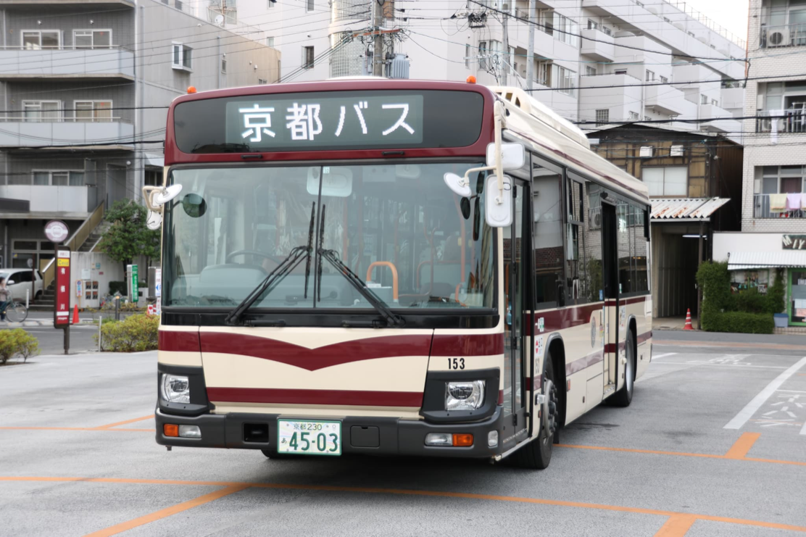
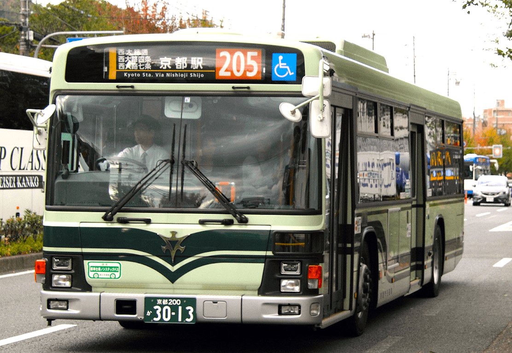
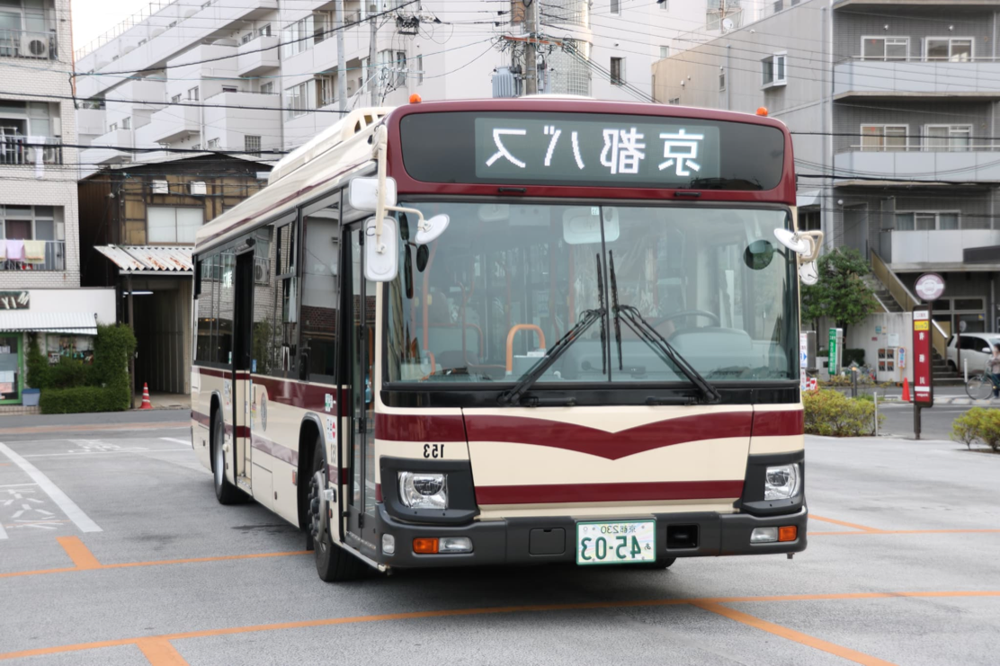

# Image embeddings with YOLO

Image embeddings represent visual features as numeric vectors, useful for
similarity search and grouping related images.
[Ultralytics' `YOLO.embed`](https://docs.ultralytics.com/reference/engine/model/#ultralytics.engine.model.Model.embed)
extracts these vectors from intermediate model layers. This tutorial builds
pipelines to generate embeddings, then compares images by measuring similarity
between their vectors.

Before you begin, follow the [Installation](../installation.md) instructions.
Run the Python snippets in order from the repository root.

## Generate embedding for images

Start with a pipeline containing only `yolo.Embed`. Pass a single image path
to extract its feature vector:

```python
from pathlib import Path

from ml_pipes.core import Pipeline
from ml_pipes.ultralytics import yolo


image_a = Path("docs/assets/image_similarity/bus-1.png")
embedding_pipeline = Pipeline(
    [yolo.Embed(model="yolo26n.pt", imgsz=640, device="cpu", rect=False)],
    auto_validate=True,
)

embedding = embedding_pipeline(str(image_a))[0]

print(f"Image: {image_a.name}")
print(f"Embedding shape: {embedding.shape}")
print(f"First 8 values: {[round(value, 6) for value in embedding[:8].tolist()]}")
```

Output:

```text
Image: bus-1.png
Embedding shape: torch.Size([256])
First 8 values: [0.197174, 2.153539, -0.241769, -0.154563, 0.325978, -0.17542, 0.29184, 0.868508]
```

`yolo.Embed` returns a native `list[torch.Tensor]`, even for one image. Here,
the list contains one one-dimensional vector. This is a representation of the
image, not a similarity score; comparison needs a second vector.

> [!TIP]
> `rect=False` keeps square letterboxing consistent across images with
> different dimensions.

??? info "How YOLO embeddings work"

    By default, YOLO takes feature maps from its second-to-last layer and
    averages each channel across its spatial dimensions to produce a
    one-dimensional vector. This represents the whole image, including its
    background.

    Embedding extraction requires a native PyTorch checkpoint; exported ONNX
    and TensorRT models do not expose these intermediate layers.

## Measure image similarity

Passing two image paths to `yolo.Embed` returns two vectors,
one per image in input order. We can add a step to compare those vectors.
The following operator validates the pair and uses PyTorch's
`cosine_similarity` to return a score between `-1` and `1`. Higher scores mean
closer feature directions, not a probability that two images are duplicates.

```python
import torch
from torch import Tensor
from torch.nn import functional as F

from ml_pipes.operator import Operator


@Operator
class CosineSimilarity:
    def __call__(self, embeddings: list[Tensor]) -> float:
        if len(embeddings) != 2:
            raise ValueError("Expected exactly two embedding vectors.")
        if any(vector.ndim != 1 or vector.numel() == 0 for vector in embeddings):
            raise ValueError("Embeddings must be non-empty, one-dimensional vectors.")
        if embeddings[0].shape != embeddings[1].shape:
            raise ValueError("Embedding vectors must have the same shape.")

        features = torch.stack(embeddings).float()
        if not torch.isfinite(features).all().item():
            raise ValueError("Embedding vectors must contain only finite values.")
        norms = torch.linalg.vector_norm(features, dim=1)
        if not torch.isfinite(norms).all().item() or (norms == 0).any().item():
            raise ValueError("Embedding vectors must have finite, non-zero norms.")

        score = F.cosine_similarity(features[0], features[1], dim=0, eps=0.0)
        return score.clamp(-1.0, 1.0).item()
```

## Build a two-image similarity pipeline

Add `CosineSimilarity` after `yolo.Embed` to turn two image paths into one
similarity score. Keep the same checkpoint and preprocessing as the
single-image example.

These two photos are sample inputs; replace their paths with any two local
images you want to compare. Both source files are 1112 pixels wide, with their
aspect ratios preserved.

| Image A: `bus-1.png` | Image B: `bus-2.png` |
|---|---|
|  |  |

```python
pipeline = Pipeline(
    [
        yolo.Embed(model="yolo26n.pt", imgsz=640, device="cpu", rect=False),
        CosineSimilarity(),
    ],
    auto_validate=True,
)

image_b = Path("docs/assets/image_similarity/bus-2.png")

print(f"Image A: {image_a.name}")
print(f"Image B: {image_b.name}")
similarity = pipeline([str(image_a), str(image_b)])
print(f"Cosine similarity: {similarity:.6f}")
```

Output:

```text
Image A: bus-1.png
Image B: bus-2.png
Cosine similarity: 0.981226
```

## Compare an image with a transformed copy

The third sample, `bus-1-flipped.png`, is a pixel-for-pixel horizontal mirror
of `bus-1.png`, not another bus photo.

| Original: `bus-1.png` | Horizontal flip: `bus-1-flipped.png` |
|---|---|
|  |  |

Pass the original and flipped paths to the same pipeline:

```python
flipped_image = Path("docs/assets/image_similarity/bus-1-flipped.png")

print(f"Image A: {image_a.name}")
print(f"Image B: {flipped_image.name}")
flip_similarity = pipeline([str(image_a), str(flipped_image)])
print(f"Cosine similarity: {flip_similarity:.6f}")
```

Output:

```text
Image A: bus-1.png
Image B: bus-1-flipped.png
Cosine similarity: 0.998215
```

| Comparison | Cosine similarity |
|---|---:|
| Two different photos | 0.981226 |
| Original photo vs its horizontal flip | 0.998215 |

The flipped copy scores closer to the original than the other bus photo.
These are two illustrative comparisons, not a calibrated similarity
benchmark. A high score does not establish that two photos show the same
vehicle or are duplicates: YOLO features are trained for detection, not
identity matching or semantic retrieval. Keep the checkpoint, embedding layer,
and preprocessing consistent; scores can vary with model versions and devices.

## Run the example

Reproduce the two comparisons from the repository root:

```bash
python examples/run_image_similarity.py --device cpu
python examples/run_image_similarity.py --device cpu --image-b docs/assets/image_similarity/bus-1-flipped.png
```

The example prints both filenames and the cosine score. Replace `--image-a`
and `--image-b` with your own local paths; `--model`, `--imgsz`, and
`--device` configure embedding extraction. See
[`run_image_similarity.py`](https://github.com/trained-by-humans/ml-pipes-ultralytics/blob/main/examples/run_image_similarity.py)
for the complete script.

The score-calculation step can later support ranking or grouping a gallery.
