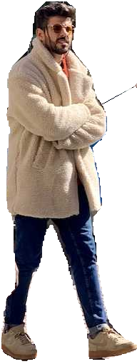

# Isolate Segmented Objects

Segment an image, then extract each object with its background removed. This
is useful for isolating segmented objects as transparent PNGs for compositing,
product images, or further processing of individual objects. Following the
[Ultralytics Object Isolation](https://docs.ultralytics.com/guides/isolating-segmentation-objects/)
workflow, this tutorial makes inference and mask-based isolation explicit
pipeline steps.

Before you begin, follow the [Installation](../installation.md) instructions.
Run the Python snippets in order in the same script or notebook.

| Before | After |
|---|---|
|  |  |

## Build the pipeline

Segmentation finds objects in an image and produces a mask for each one,
describing which pixels belong to that object. The pipeline first runs a
YOLO segmentation model to obtain these masks. See
[Segment and Annotate](segment_and_annotate.md) for more about segmentation.

`IsolateObjects` then uses each mask to separate the object from its
background. It keeps the object's pixels, makes the surrounding pixels
transparent, and saves the isolated object as a PNG:

??? note "Define the IsolateObjects operator"

    ```python
    import re
    from pathlib import Path
    from typing import Literal
    from uuid import uuid4

    import cv2
    import numpy as np
    from ultralytics.engine.results import Results

    from ml_pipes.operator import Operator


    @Operator
    class IsolateObjects:
        """Rasterize native mask polygons and save isolated objects as PNG files."""

        def __init__(
            self,
            output_dir: Path,
            *,
            source_name: str = "image",
            crop: bool = False,
            background: Literal["transparent", "black"] = "transparent",
        ) -> None:
            if background not in {"transparent", "black"}:
                raise ValueError("background must be 'transparent' or 'black'.")
            self.output_dir = Path(output_dir)
            self.source_name = self._filename_part(source_name)
            self.crop = crop
            self.background = background

        @staticmethod
        def _filename_part(value: str) -> str:
            return re.sub(r"[^a-zA-Z0-9_-]+", "_", value)[:80].strip("_") or "unknown"

        def __call__(self, result: Results) -> list[Path]:
            self.output_dir.mkdir(parents=True, exist_ok=True)
            if result.masks is None or result.boxes is None or len(result.boxes) == 0:
                return []

            image = result.orig_img
            height, width = image.shape[:2]
            native_boxes = result.boxes.cpu().numpy()
            boxes = native_boxes.xyxy
            classes = native_boxes.cls
            # masks.xy removes inference letterboxing and scales to orig_img pixels.
            polygons = result.masks.xy
            run_id = uuid4().hex
            paths = []
            for index, (polygon, box, class_id) in enumerate(zip(polygons, boxes, classes)):
                if len(polygon) < 3:
                    continue
                mask = np.zeros((height, width), dtype=np.uint8)
                contour = np.rint(polygon).astype(np.int32).reshape(-1, 1, 2)
                cv2.fillPoly(mask, [contour], 255)
                if not mask.any():
                    continue

                isolated = cv2.bitwise_and(image, image, mask=mask)
                if self.background == "transparent":
                    isolated = cv2.cvtColor(isolated, cv2.COLOR_BGR2BGRA)
                    isolated[:, :, 3] = mask
                if self.crop:
                    x0, y0 = np.clip(np.floor(box[:2]), [0, 0], [width, height]).astype(int)
                    x1, y1 = np.clip(np.ceil(box[2:]), [0, 0], [width, height]).astype(int)
                    if x0 >= x1 or y0 >= y1:
                        continue
                    isolated = isolated[y0:y1, x0:x1]

                class_id = int(class_id)
                label = self._filename_part(result.names[class_id])
                path = self.output_dir / (
                    f"{self.source_name}_{run_id}_object-{index:03d}_class-{class_id}-{label}.png"
                )
                if not cv2.imwrite(str(path), isolated):
                    raise OSError(f"Could not save {path}")
                paths.append(path)
            return paths
    ```

Here, `crop=True` also trims each isolated image to the object's bounding
box, like [Detect and Crop](detect_and_crop.md). The mask removes the
background within that box as well.

```python
from ml_pipes.core import Pipeline
from ml_pipes.standard import Select
from ml_pipes.ultralytics import yolo

pipeline = Pipeline(
    [
        yolo.Predict(model="yolo26n-seg.pt", conf=0.25),
        Select(0),
        IsolateObjects(Path("isolated-objects"), source_name="bus", crop=True),
    ],
    auto_validate=True,
)
```

You can also set `background="black"` to write opaque, three-channel PNGs. The native polygon
representation does not preserve interior holes in the mask tensor.

## Run it on an image

The pipeline accepts the BGR array decoded by OpenCV and returns the saved
PNG paths. Mask isolation and PNG writing happen inside the configured
`IsolateObjects` operator.

```python
import cv2

image = cv2.imread("bus.jpg")
if image is None:
    raise RuntimeError("Could not load bus.jpg")

paths = pipeline(image)
print(f"Saved {len(paths)} isolated objects")
for path in paths:
    print(path)
```

The bus and person PNGs below are produced by the isolation step. Their
backgrounds are transparent, including the areas around each object within
its bounding box.

| Isolated bus | Isolated person |
|---|---|
|  |  |

Files are written to `isolated-objects/` with names such as
`bus_<uuid>_object-000_class-0-person.png`. The source stem, invocation UUID,
object index, and class identifier distinguish objects of the same class and
prevent repeated calls from overwriting previous exports. Missing masks or
empty detections return an empty path list without deleting earlier files.

## Run the example

To run the complete example script instead,
[clone the repository](../installation.md#get-the-tutorial-files), then run
these commands from its root directory:

```bash
python examples/run_isolate_segmented_objects.py --crop
python examples/run_isolate_segmented_objects.py --source path/to/image.jpg --crop
python examples/run_isolate_segmented_objects.py --crop --background black
```

The example uses the bundled bus image by default and saves PNGs under
`examples/.example_assets/isolated-objects/`. Use `--output-dir` to choose a
different directory. It also exposes the model, confidence, classes, and
device through `--model`, `--conf`, `--classes`, and `--device`.

See [`run_isolate_segmented_objects.py`](https://github.com/trained-by-humans/ml-pipes-ultralytics/blob/main/examples/run_isolate_segmented_objects.py)
for all command-line options.
