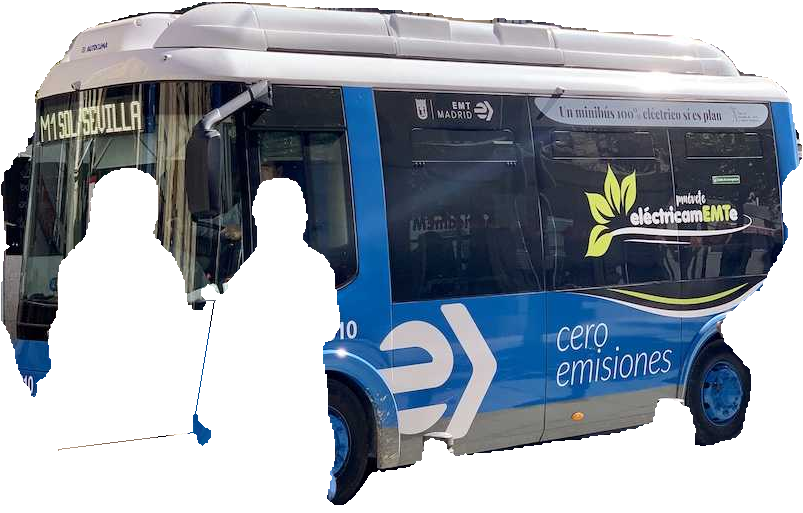

# Isolate Segmented Objects

Instance segmentation gives each detected object its own mask. The
[Segment and Annotate](segment_and_annotate.md) tutorial renders those masks
over an image. Here we use them to extract individual objects as reusable
PNG assets, following the workflow in the
[Ultralytics object isolation guide](https://docs.ultralytics.com/guides/isolating-segmentation-objects/).

Before you begin, follow the [Installation](../installation.md) instructions.
Run the Python snippets in order in the same script or notebook, with a local
`bus.jpg` input. The runnable example below supplies the bundled bus image.

| Input | Isolated bus (`--classes 5 --crop`) |
|---|---|
|  |  |

## Isolate objects from native Results

Keep the native `Results` returned by `yolo.Predict`. The custom operator
below consumes its original BGR image, class IDs, boxes, and mask polygons.
`result.masks.xy` provides polygon coordinates in original-image pixels,
after undoing inference resizing and letterbox padding. Resizing the padded
`masks.data` tensor directly to the image size would misalign the mask.

Rasterize each polygon into a binary mask, keep the object's BGR pixels, and
use the mask as the PNG alpha channel. Pixels outside the object are black
with alpha zero. This follows the native polygon representation; rasterizing
contours does not preserve interior holes in the original mask tensor.

```python
import re
from pathlib import Path
from uuid import uuid4

import cv2
import numpy as np
from ultralytics.engine.results import Results

from ml_pipes.operator import Operator


@Operator
class IsolateObjects:
    """Rasterize native mask polygons and save isolated objects as PNG files."""

    def __init__(
        self,
        output_dir: Path,
        *,
        source_name: str = "image",
        crop: bool = False,
        background: str = "transparent",
    ) -> None:
        if background not in {"transparent", "black"}:
            raise ValueError("background must be 'transparent' or 'black'.")
        self.output_dir = Path(output_dir)
        self.source_name = self._filename_part(source_name)
        self.crop = crop
        self.background = background

    @staticmethod
    def _filename_part(value: str) -> str:
        return re.sub(r"[^a-zA-Z0-9_-]+", "_", value)[:80].strip("_") or "unknown"

    def __call__(self, result: Results) -> list[Path]:
        self.output_dir.mkdir(parents=True, exist_ok=True)
        if result.masks is None or result.boxes is None or len(result.boxes) == 0:
            return []

        image = result.orig_img
        height, width = image.shape[:2]
        native_boxes = result.boxes.cpu().numpy()
        boxes = native_boxes.xyxy
        classes = native_boxes.cls
        # masks.xy removes inference letterboxing and scales to orig_img pixels.
        polygons = result.masks.xy
        run_id = uuid4().hex
        paths = []
        for index, (polygon, box, class_id) in enumerate(zip(polygons, boxes, classes)):
            if len(polygon) < 3:
                continue
            mask = np.zeros((height, width), dtype=np.uint8)
            contour = np.rint(polygon).astype(np.int32).reshape(-1, 1, 2)
            cv2.fillPoly(mask, [contour], 255)
            if not mask.any():
                continue

            isolated = cv2.bitwise_and(image, image, mask=mask)
            if self.background == "transparent":
                isolated = cv2.cvtColor(isolated, cv2.COLOR_BGR2BGRA)
                isolated[:, :, 3] = mask
            if self.crop:
                x0, y0 = np.clip(np.floor(box[:2]), [0, 0], [width, height]).astype(int)
                x1, y1 = np.clip(np.ceil(box[2:]), [0, 0], [width, height]).astype(int)
                if x0 >= x1 or y0 >= y1:
                    continue
                isolated = isolated[y0:y1, x0:x1]

            class_id = int(class_id)
            label = self._filename_part(result.names[class_id])
            path = self.output_dir / (
                f"{self.source_name}_{run_id}_object-{index:03d}_class-{class_id}-{label}.png"
            )
            if not cv2.imwrite(str(path), isolated):
                raise OSError(f"Could not save {path}")
            paths.append(path)
        return paths
```

With `crop=True`, box minima round down and maxima round up, then all
coordinates are clamped to the original image dimensions before slicing.
Zero-area or inverted crops are skipped. `background="black"` writes a
three-channel PNG instead of a four-channel PNG with transparency.
No masks, no boxes, no detections, or empty polygons produce an empty path
list and an output directory without new files.

## Build the pipeline

Use an instance-segmentation checkpoint (`-seg`), select the single image's
result, then export its objects. Configuration belongs to the operators;
the pipeline call receives only the image.

```python
from ml_pipes.core import Pipeline
from ml_pipes.standard import Select
from ml_pipes.ultralytics import yolo

pipeline = Pipeline(
    [
        yolo.Predict(model="yolo26n-seg.pt", conf=0.25),
        Select(0),
        IsolateObjects(
            Path("isolated-objects"),
            source_name="bus",
            crop=False,
            background="transparent",
        ),
    ],
    auto_validate=True,
)
```

## Run it on an image

```python
image = cv2.imread("bus.jpg")
if image is None:
    raise RuntimeError("Could not load bus.jpg")

paths = pipeline(image)
print(f"Saved {len(paths)} isolated objects")
for path in paths:
    print(path)
```

Each returned path identifies one PNG. Without cropping, PNG dimensions match
the input image; with cropping, each PNG matches its bounded detection box.
The original image and native results remain available without modification.

Filenames include a sanitized source stem, a fresh invocation UUID, the
object's index in the result, and its class ID and label. For example,
`bus_<uuid>_object-000_class-0-person.png` identifies one person. Two people
have different object indices; repeated calls and source files with the same
stem receive different UUIDs. Re-running the example adds new files. A run
with no detections does not delete earlier exports.

## Run the example

To run the complete example script instead,
[clone the repository](../installation.md#get-the-tutorial-files), then run
these commands from its root directory:

```bash
# Full-size PNGs with transparent backgrounds, using the bundled bus image.
python examples/run_isolate_segmented_objects.py

# Cropped transparent objects from a local image, keeping COCO person class 0.
python examples/run_isolate_segmented_objects.py \
  --source path/to/image.jpg --output-dir isolated-people \
  --model yolo26n-seg.pt --conf 0.4 --classes 0 --device cpu --crop

# Cropped objects on opaque black backgrounds.
python examples/run_isolate_segmented_objects.py \
  --output-dir isolated-black --crop --background black
```

The default output directory is `examples/.example_assets/isolated-objects/`.
The CLI prints the exported count and each saved path, including a count of
zero when no objects remain. It also exposes IoU, inference size, and maximum
detection count through `--iou`, `--imgsz`, and `--max-det`.

See [`run_isolate_segmented_objects.py`](https://github.com/trained-by-humans/ml-pipes-ultralytics/blob/main/examples/run_isolate_segmented_objects.py)
for all command-line options. Tests use synthetic native results and images;
CI does not download a segmentation checkpoint or run real inference.
